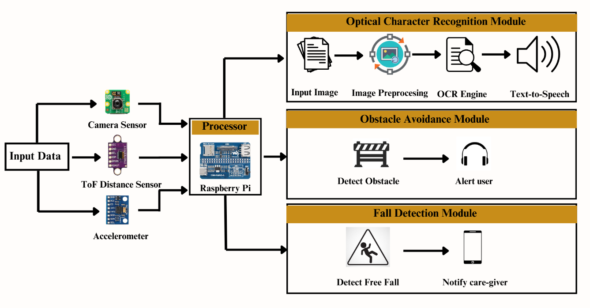
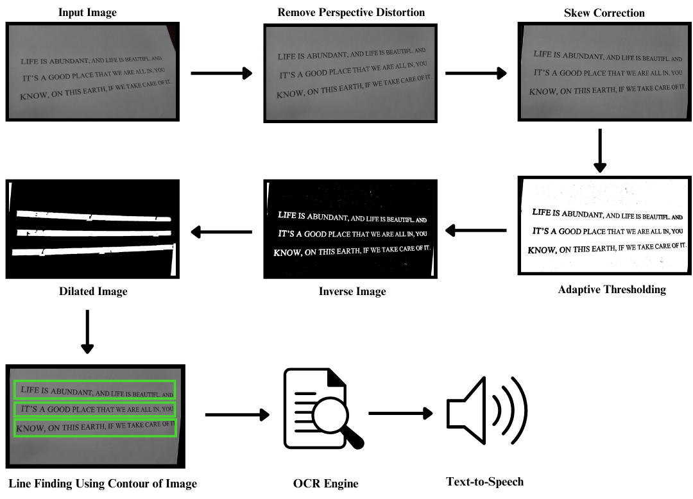
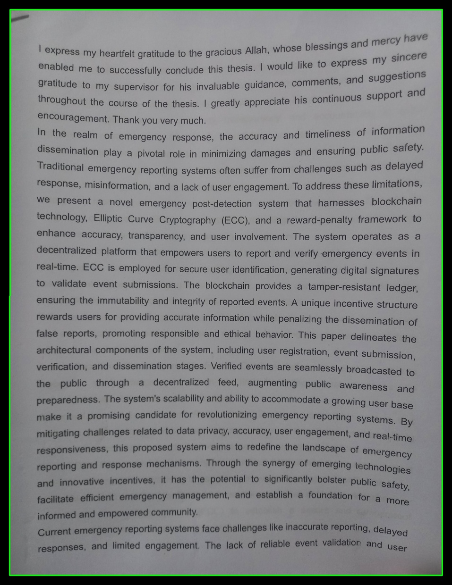
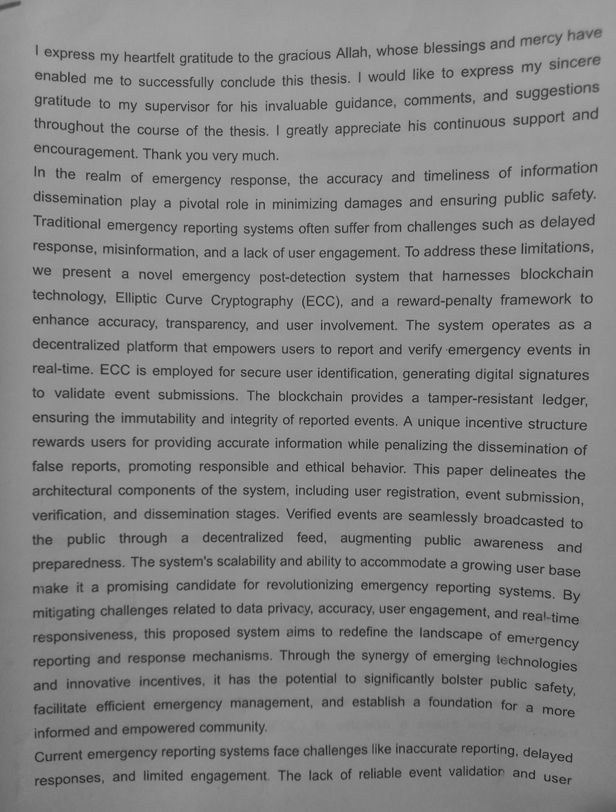
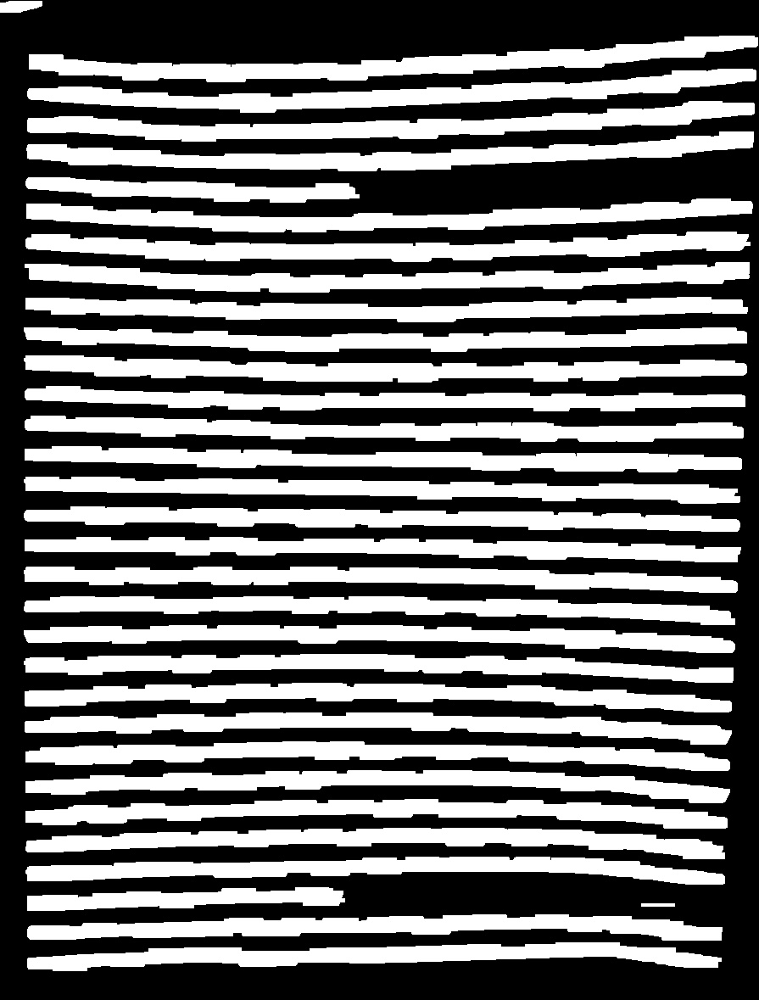
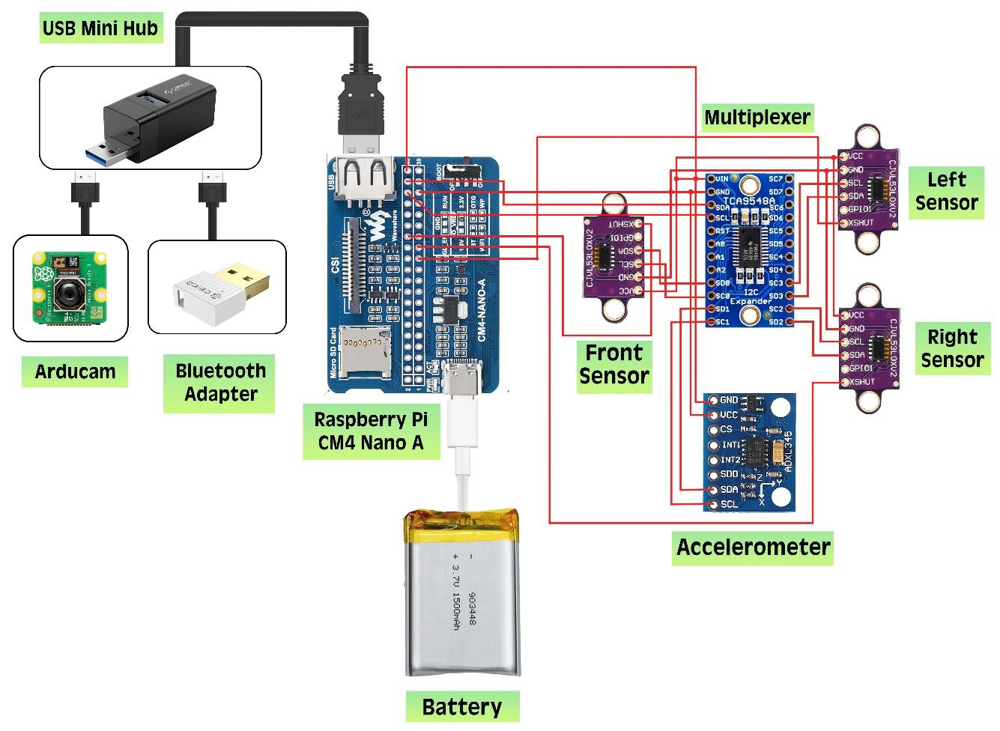

# Assistive Device for the Visually Impaired for Enhanced Navigation and Reading

It is a lightweight, low-cost spectacle built on a Raspberry Pi. It helps visually impaired people with two everyday tasks:

- **Moving safely:** laser distance sensors detect obstacles ahead and the device gives an audio alert. An accelerometer detects falls and notifies a caregiver.
- **Reading:** a camera captures a document, an image-processing pipeline cleans it up, Tesseract OCR reads it, and the text is spoken aloud.

## Results

| Module | Result |
| --- | --- |
| Obstacle detection (distance accuracy) | 99.46% indoor, 99.36% outdoor |
| OCR, character level | CER 6.97%, precision 94.45%, recall 96.07% |
| OCR, word level | WER 9.46%, precision 91.62%, recall 94.22% |

OCR was tested on 25 document images (21,852 characters, 4,482 words).

## Repository structure

```
├── ocr/              Final OCR + text-to-speech pipeline
│   ├── ocr.py
│   └── utils.py
├── hardware/         Raspberry Pi scripts
│   ├── laser_sensor.py   VL53L0X distance sensing
│   ├── webcam.py         Captures a frame and runs detection
│   ├── detect.py         YOLOv5 object detection (extension)
│   └── fall_detection.py ADXL345 fall detection
├── experiments/      Step-by-step prototypes of each OCR stage
├── sample_dataset/   8 sample document images
└── docs/images/      Figures used in this README
```

## System architecture



The camera, the ToF distance sensors and the accelerometer feed a Raspberry Pi, which runs three modules: optical character recognition, obstacle avoidance and fall detection.

## How it works

### 1. Obstacle avoidance
VL53L0X time-of-flight laser sensors measure the distance to objects in front of the user. In the full prototype, three sensors share one I2C bus through a TCA9548A multiplexer. When an object comes closer than a set threshold, the device says *"Alert! Obstacle ahead"*.

`hardware/laser_sensor.py` is the single-sensor version. When an object is detected, it calls `webcam.py`, which captures a frame and runs a YOLOv5 model (`detect.py`) to identify the object. Camera-based object detection was an extension beyond the thesis scope.

### 2. Fall detection
`hardware/fall_detection.py` reads the ADXL345 accelerometer continuously. During a fall, the total acceleration drops close to zero. If it stays below a free-fall threshold for several readings in a row, a "Fall Detected" message is sent to the guardian through a Telegram bot.

### 3. Optical character recognition (OCR)



| Document outline detected | After perspective correction | Line segmentation (dilation) |
| --- | --- | --- |
|  |  |  |

`ocr/ocr.py` runs these steps:

1. **Perspective correction:** Canny edge detection and contour finding locate the page; a four-point perspective transform gives a top-down view.
2. **Skew correction:** the image is rotated over a range of angles and the angle with the best row-histogram score is kept.
3. **Enhancement:** a high-boost filter sharpens the text and a bilateral filter removes noise.
4. **Thresholding:** the image is binarized to separate text from background.
5. **Line extraction:** dilation with a wide (4 × 40) kernel merges each text line into one block; contours give a bounding box per line.
6. **Border clearing:** morphological reconstruction removes parts of neighbouring lines that fall inside a line's box.
7. **Recognition:** each line is read by Tesseract (`--psm 7`), and misspelled words are corrected with TextBlob.
8. **Speech:** the final text is spoken with Google Text-to-Speech (gTTS).

## Hardware



| Component | Purpose |
| --- | --- |
| Raspberry Pi CM4 | Main processor |
| 3 × VL53L0X ToF laser sensor | Obstacle distance |
| TCA9548A I2C multiplexer | Runs several sensors with the same I2C address |
| ADXL345 accelerometer | Fall detection |
| Arducam 8MP (Sony IMX219) | Document and scene capture |
| LiPo battery, Bluetooth adapter | Power and audio output |

Total prototype cost: about 16,100 BDT.

## Running the OCR pipeline

1. Install [Tesseract OCR](https://github.com/tesseract-ocr/tesseract).
2. Install the Python packages:
   ```bash
   pip install -r requirements.txt
   python -m textblob.download_corpora
   ```
3. In `ocr/ocr.py`, set:
   - `pytesseract.pytesseract.tesseract_cmd` to your Tesseract path (line 19)
   - the input image in `cv2.imread(...)` (line 226), e.g. `../sample_dataset/test15.jpg`
4. Run it from the `ocr/` folder:
   ```bash
   cd ocr
   python ocr.py
   ```

The hardware scripts run on the Raspberry Pi and need `RPi.GPIO`, the [VL53L0X Python library](https://github.com/johnbmoore/VL53L0X_rasp_python), and a [YOLOv5](https://github.com/ultralytics/yolov5) setup with trained weights. File paths inside them point to `/home/pi/...` and may need editing.

For fall detection, install `adafruit-circuitpython-adxl34x` and `requests`, then set `BOT_TOKEN` and `CHAT_ID` in `hardware/fall_detection.py` to your Telegram bot token and the guardian's chat ID.
